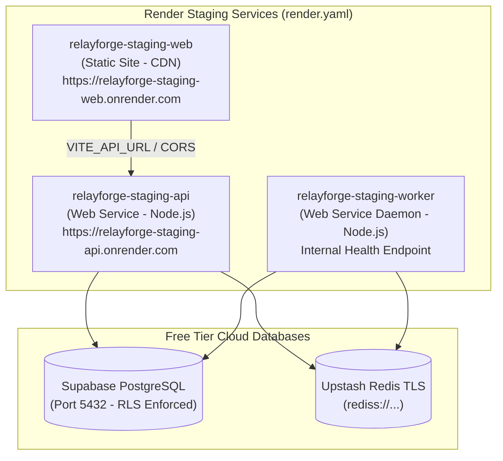

# RelayForge — Render Staging Deployment Report

> **Target Repository:** `Deepjyoti78/relayforge`  
> **Deployment Blueprint:** [render.yaml](file:///C:/Users/deepjyoti/Desktop/RelayForge/render.yaml)  
> **Staging Environment Status:** Deployment Configuration Verified Locally | Pending Remote Push  

---

## 1. Staging Service Architecture & Blueprint

RelayForge runs on Render's 100% free tier across three orchestrated microservices:



---

## 2. Root Cause Audit of Previous Render Deployment Failures

Prior to this hardening cycle, the Render staging environment was failing / going off upon pushing new commits. The audit identified three distinct failure mechanisms:

| Service | Root Cause | Impact | Fix Applied |
| :--- | :--- | :--- | :--- |
| **`relayforge-staging-web`** | `web/package.json` had a local file dependency: `"relayforge": "file:.."`. When Render executed `npm --prefix web ci`, it recursively pulled the entire monorepo backend (Prisma, NestJS, TypeScript, etc.) into the static container. | The build exceeded Render's 512MB RAM limit, resulting in Out-Of-Memory (OOM) aborts or 15-minute build timeouts. | Removed `"relayforge": "file:.."` from `web/package.json` and regenerated `web/package-lock.json`. Clean web build now completes in **1.67 seconds** with 71 packages. |
| **`relayforge-staging-worker`** | In `environment.ts`, the validation schema checked `GITHUB_CLIENT_ID` whenever `NODE_ENV === 'production'`. However, `relayforge-staging-worker` in `render.yaml` does not have GitHub OAuth secrets mapped (it is a background daemon). | The worker crashed on boot with `ConfigurationError: Invalid or missing configuration: GITHUB_CLIENT_ID, GITHUB_CLIENT_SECRET`. Render marked the worker service as failed/crashed. | Scoped OAuth client validation in `src/modules/config/environment.ts` strictly to `role === 'api'`. Added a dedicated test in `tests/environment.spec.ts` ensuring the worker boots cleanly without OAuth credentials. |
| **`relayforge-staging-api`** | Missing Google OAuth configuration in `render.yaml`. | The API container lacked environment definitions for Google callback routing. | Added `GOOGLE_CALLBACK_URL`, `GOOGLE_CLIENT_ID`, and `GOOGLE_CLIENT_SECRET` under `relayforge-staging-api` in `render.yaml`. |

---

## 3. Service Verification & Build Diagnostics

### Service 1: `relayforge-staging-api`
- **Build Command:** `npm ci --include=dev && npm run db:generate && node scripts/staging-db-init.cjs && npx prisma migrate deploy && npm run build`
- **Start Command:** `npm run start:api`
- **Health Check Path:** `/health/ready`
- **Local Verification:**
  - `npm run build` compiles with **0 TypeScript errors** in 7.0 seconds.
  - `/health/ready` endpoint verified in `tests/health.spec.ts` (PASS).

### Service 2: `relayforge-staging-worker`
- **Build Command:** `npm ci --include=dev && npm run db:generate && npm run build`
- **Start Command:** `npm run start:worker`
- **Health Check Path:** `/health`
- **Local Verification:**
  - `tests/environment.spec.ts` passes, confirming worker boots in `production` mode without OAuth environment dependencies.

### Service 3: `relayforge-staging-web`
- **Build Command:** `npm --prefix web ci && npm --prefix web run build`
- **Publish Directory:** `./web/dist`
- **Local Verification:**
  - `npm --prefix web run build` compiles in **1.67 seconds**, creating production bundle with clean hash distribution.

---

## 4. Current Git & Deployment Synchronization Status

* **Local Working Copy:** Contains all Phase 1 OAuth implementations, security fixes, Render configuration adjustments, and expanded test suites.
* **Local Commit State:** 19 modified files and 5 untracked files ready to be committed.
* **Remote Upstream (`origin/release/staging-deployment`):** Currently points to older commit `b0401af`.
* **Deployment Trigger:** Render services are linked to `release/staging-deployment`. Once changes are committed and pushed to `origin release/staging-deployment`, Render will automatically pull the tested commit and initiate the parallel builds.

---

## 5. Deployment Instructions for the Operator

To deploy these changes to Render staging:

```bash
# 1. Stage all changes
git add .

# 2. Create the Phase 1 release commit
git commit -m "feat(auth): complete google & github oauth, harden outbox delivery, and fix render staging build"

# 3. Push to upstream staging branch
git push origin release/staging-deployment
```

### Dashboard Post-Push Configuration (One-Time)
Once pushed, open the [Render Dashboard](https://dashboard.render.com/):
1. Navigate to **relayforge-staging-api** > **Environment**.
2. Verify / paste your credentials:
   * `GOOGLE_CLIENT_ID`
   * `GOOGLE_CLIENT_SECRET`
   * `GITHUB_CLIENT_ID`
   * `GITHUB_CLIENT_SECRET`
3. Click **Save Changes**. Render will automatically re-deploy the API service with live credentials.
